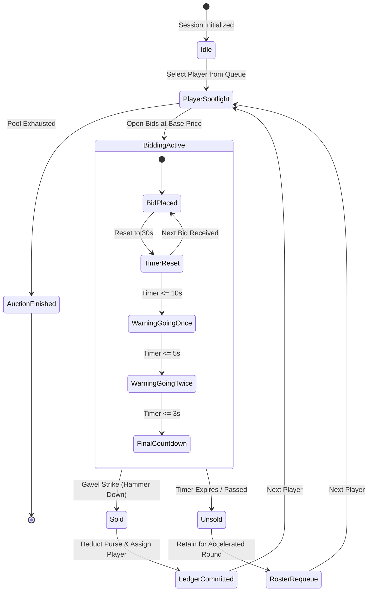

# NTL Auction Platform – Auction Engine Architecture

## 1. Engine Core Principles
The Auction Engine is designed around 4 core principles:
1. **Deterministic Bidding**: At any millisecond, there is exactly one authoritative state of the current player, high bidder, and bid value.
2. **Atomic Budget Enforcement**: A team cannot bid if `(remaining_purse - bid_amount) < (unfilled_minimum_squad_spots * base_minimum_price)`.
3. **Sub-second Propagation**: Bid events are broadcast via WebSockets to all connected displays within 150ms.
4. **Resilient Transaction Rollback**: Full undo history with reverse ledger accounting for human errors during intense live auctions.

---

## 2. Dynamic Bid Increment Ladder (Slab Matrix)

Bids automatically adjust their minimum step based on the current price tier:

| Price Range | Minimum Increment | Example Transition |
| :--- | :--- | :--- |
| **₹10,000 – ₹1,00,000** | +₹10,000 | ₹40,000 -> ₹50,000 |
| **₹1,00,000 – ₹5,00,000** | +₹25,000 | ₹1,50,000 -> ₹1,75,000 |
| **₹5,00,000 – ₹10,00,000** | +₹50,000 | ₹6,00,000 -> ₹6,50,000 |
| **₹10,00,000+** | +₹1,00,000 | ₹11,00,000 -> ₹12,00,000 |

*Auctioneers can override the slab using quick increment buttons (+₹10k, +₹25k, +₹50k, +₹1L) or custom manual input.*

---

## 3. Squad & Purse Reserve Formula

To prevent a franchise from blowing its budget on stars and failing to assemble the mandatory 15-player minimum squad:

$$\text{Reserved Balance} = \max(0, \text{Min Players} - \text{Current Squad Size} - 1) \times \text{Base Price Floor}$$

Where:
- $\text{Min Players} = 15$
- $\text{Base Price Floor} = ₹25,000$ (lowest registered tier price)

$$\text{Max Allowable Bid} = \text{Remaining Purse} - \text{Reserved Balance}$$

If a bid exceeds $\text{Max Allowable Bid}$, the UI disables the bidding button for that team, and the database trigger rejects any inbound bid attempt with SQL error `ERR_INSUFFICIENT_PURSE_RESERVE`.

---

## 4. State Machine: Auction Lifecycle

---

## 5. Undo & Audit Transaction Log

In fast-paced stage auctions, an auctioneer might accidentally click the wrong team.
The system provides a two-level rollback:

1. **Undo Last Bid**:
   - Reverts `current_highest_bid` to the previous bid in `bids` table.
   - Restores the previous leading team.
   - Appends an `UNDONE` record in `bids` table with timestamp and reason.
   - Resets countdown timer to 20 seconds.

2. **Undo Sale (Post-Hammer Rollback)**:
   - Removes entry from `purchases`.
   - Restores the deducted balance back to `team_purses`.
   - Reverts player status from `SOLD` to `ON_AUCTION`.
   - Broadcasts reconciliation event to all connected public stage monitors.
