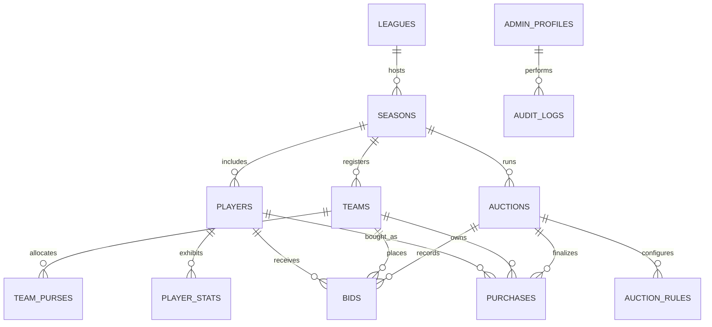

# NTL Auction Platform – Database Schema Specification

## 1. Relational Entity Relationship Diagram



---

## 2. Table Specifications

### 2.1 `leagues`
Root organization entity.
| Column | Type | Constraints | Description |
| :--- | :--- | :--- | :--- |
| `id` | `UUID` | PK, default `gen_random_uuid()` | Unique league identifier |
| `slug` | `VARCHAR(64)` | UNIQUE, NOT NULL | URL-safe slug (e.g. `ntl`) |
| `name` | `VARCHAR(255)` | NOT NULL | Full name (e.g. `Nalanda Turf League`) |
| `logo_url` | `TEXT` | NULL | Public CDN URL for league logo |
| `primary_color`| `VARCHAR(16)` | DEFAULT `'#059669'` | Hex brand accent color |
| `created_at` | `TIMESTAMPTZ` | DEFAULT `NOW()` | Timestamp |

### 2.2 `seasons`
Specific edition of a league.
| Column | Type | Constraints | Description |
| :--- | :--- | :--- | :--- |
| `id` | `UUID` | PK | Unique season identifier |
| `league_id` | `UUID` | FK -> `leagues.id` ON DELETE CASCADE | Parent league |
| `edition` | `INT` | NOT NULL | e.g., 1 for Season 1 |
| `year` | `INT` | NOT NULL | e.g., 2026 |
| `status` | `VARCHAR(32)` | DEFAULT `'UPCOMING'` | `UPCOMING`, `LIVE`, `COMPLETED` |
| `created_at` | `TIMESTAMPTZ` | DEFAULT `NOW()` | Timestamp |

### 2.3 `teams`
Franchises competing in a season.
| Column | Type | Constraints | Description |
| :--- | :--- | :--- | :--- |
| `id` | `UUID` | PK | Unique franchise ID |
| `season_id` | `UUID` | FK -> `seasons.id` ON DELETE CASCADE | Parent season |
| `name` | `VARCHAR(255)` | NOT NULL | e.g. `Nalanda Strikers` |
| `short_code` | `VARCHAR(8)` | NOT NULL | e.g. `NST` |
| `logo_url` | `TEXT` | NULL | Franchise vector/high-res crest |
| `owner_name` | `VARCHAR(255)` | NULL | Franchise owner |
| `owner_photo_url`| `TEXT` | NULL | Photograph of team owner |
| `icon_player_id` | `UUID` | NULL | Reference to pre-allocated icon player |
| `created_at` | `TIMESTAMPTZ` | DEFAULT `NOW()` | Timestamp |

### 2.4 `team_purses`
Tracks dynamic balance, spent funds, and reserved purse guarantees.
| Column | Type | Constraints | Description |
| :--- | :--- | :--- | :--- |
| `id` | `UUID` | PK | Unique purse identifier |
| `team_id` | `UUID` | FK -> `teams.id` UNIQUE, ON DELETE CASCADE | Linked franchise |
| `total_budget`| `BIGINT` | NOT NULL, CHECK (total_budget >= 0) | Initial purse (e.g. ₹50,00,000) |
| `spent_amount`| `BIGINT` | DEFAULT 0, CHECK (spent_amount >= 0) | Cumulative spent funds |
| `remaining_amount`| `BIGINT` | GENERATED ALWAYS AS (total_budget - spent_amount) STORED | Calculated purse balance |
| `min_players` | `INT` | DEFAULT 15 | Minimum squad size required |
| `max_players` | `INT` | DEFAULT 18 | Maximum squad size allowed |
| `reserved_for_squad`| `BIGINT` | DEFAULT 0 | Purse reserved for unfilled minimum squad spots |
| `updated_at` | `TIMESTAMPTZ` | DEFAULT `NOW()` | Last ledger update |

### 2.5 `players`
Player registry imported from Google Sheets or entered via Admin.
| Column | Type | Constraints | Description |
| :--- | :--- | :--- | :--- |
| `id` | `UUID` | PK | Unique player ID |
| `season_id` | `UUID` | FK -> `seasons.id` | Target season |
| `registration_no`| `VARCHAR(64)`| NOT NULL | e.g., `NTL-2026-001` |
| `full_name` | `VARCHAR(255)` | NOT NULL | Player display name |
| `category` | `VARCHAR(64)` | NOT NULL | `ICON`, `PLATINUM`, `GOLD`, `SILVER`, `EMERGING` |
| `primary_role`| `VARCHAR(64)`| NOT NULL | `BATSMAN`, `BOWLER`, `ALL_ROUNDER`, `WICKET_KEEPER` |
| `batting_style`| `VARCHAR(64)`| NULL | `RIGHT_HAND`, `LEFT_HAND` |
| `bowling_style`| `VARCHAR(64)`| NULL | `RIGHT_ARM_FAST`, `LEFT_ARM_SPIN`, etc. |
| `photo_url` | `TEXT` | NULL | High-res headshot (Google Drive/Supabase storage) |
| `base_price` | `BIGINT` | NOT NULL | Base starting bid (e.g. ₹50,000) |
| `status` | `VARCHAR(32)` | DEFAULT `'AVAILABLE'` | `AVAILABLE`, `ON_AUCTION`, `SOLD`, `UNSOLD`, `WITHDRAWN` |
| `created_at` | `TIMESTAMPTZ` | DEFAULT `NOW()` | Timestamp |

### 2.6 `auctions`
Live auction room session.
| Column | Type | Constraints | Description |
| :--- | :--- | :--- | :--- |
| `id` | `UUID` | PK | Unique auction ID |
| `season_id` | `UUID` | FK -> `seasons.id` | Season reference |
| `current_player_id` | `UUID` | FK -> `players.id` NULL | Currently spotlighted player |
| `current_highest_bid`| `BIGINT` | DEFAULT 0 | Current standing bid |
| `current_leading_team_id`| `UUID` | FK -> `teams.id` NULL | Current high bidder |
| `status` | `VARCHAR(32)` | DEFAULT `'PAUSED'` | `IDLE`, `IN_PROGRESS`, `PAUSED`, `FINISHED` |
| `timer_seconds` | `INT` | DEFAULT 30 | Countdown timer |
| `round` | `INT` | DEFAULT 1 | 1 = regular, 2 = accelerated unsold round |
| `updated_at` | `TIMESTAMPTZ` | DEFAULT `NOW()` | Timestamp |

### 2.7 `bids`
Immutable audit log of all bids placed during auction sessions.
| Column | Type | Constraints | Description |
| :--- | :--- | :--- | :--- |
| `id` | `UUID` | PK | Unique bid transaction ID |
| `auction_id` | `UUID` | FK -> `auctions.id` | Auction session |
| `player_id` | `UUID` | FK -> `players.id` | Player auctioned |
| `team_id` | `UUID` | FK -> `teams.id` | Bidding franchise |
| `amount` | `BIGINT` | NOT NULL | Bid amount in INR |
| `bid_type` | `VARCHAR(32)` | DEFAULT `'STANDARD'` | `BASE`, `STANDARD`, `OVERRIDE`, `UNDONE` |
| `placed_at` | `TIMESTAMPTZ` | DEFAULT `NOW()` | Timestamp (microsecond precision) |

### 2.8 `purchases`
Finalized player sales.
| Column | Type | Constraints | Description |
| :--- | :--- | :--- | :--- |
| `id` | `UUID` | PK | Purchase record ID |
| `auction_id` | `UUID` | FK -> `auctions.id` | Auction session |
| `player_id` | `UUID` | FK -> `players.id` UNIQUE | Player sold |
| `team_id` | `UUID` | FK -> `teams.id` | Purchasing franchise |
| `final_price` | `BIGINT` | NOT NULL | Winning bid |
| `sold_at` | `TIMESTAMPTZ` | DEFAULT `NOW()` | Timestamp |

---

## 3. Database Functions & Triggers

### Atomic Bid Function (`sp_place_bid`)
```sql
CREATE OR REPLACE FUNCTION sp_place_bid(
    p_auction_id UUID,
    p_team_id UUID,
    p_player_id UUID,
    p_amount BIGINT
) RETURNS JSONB
LANGUAGE plpgsql
AS $$
DECLARE
    v_purse RECORD;
    v_auction RECORD;
    v_players_count INT;
    v_min_remaining BIGINT;
    v_new_bid_id UUID;
BEGIN
    -- 1. Lock auction record
    SELECT * INTO v_auction FROM auctions WHERE id = p_auction_id FOR UPDATE;
    IF v_auction.status != 'IN_PROGRESS' THEN
        RAISE EXCEPTION 'Auction is not in progress';
    END IF;

    -- 2. Validate bid amount is strictly greater than current
    IF p_amount <= v_auction.current_highest_bid THEN
        RAISE EXCEPTION 'Bid must be strictly higher than current bid of %', v_auction.current_highest_bid;
    END IF;

    -- 3. Lock & validate team purse
    SELECT * INTO v_purse FROM team_purses WHERE team_id = p_team_id FOR UPDATE;
    SELECT COUNT(*) INTO v_players_count FROM purchases WHERE team_id = p_team_id;

    -- Check squad max capacity
    IF v_players_count >= v_purse.max_players THEN
        RAISE EXCEPTION 'Team has reached maximum squad limit of % players', v_purse.max_players;
    END IF;

    -- Calculate reserved balance for remaining minimum squad slots
    -- (min_players - current - 1) * base_minimum_price (₹25,000)
    v_min_remaining := GREATEST(0, (v_purse.min_players - v_players_count - 1)) * 25000;
    IF (v_purse.remaining_amount - p_amount) < v_min_remaining THEN
        RAISE EXCEPTION 'Insufficient purse: Team must reserve % for remaining squad slots', v_min_remaining;
    END IF;

    -- 4. Record bid in ledger
    INSERT INTO bids (auction_id, player_id, team_id, amount)
    VALUES (p_auction_id, p_player_id, p_team_id, p_amount)
    RETURNING id INTO v_new_bid_id;

    -- 5. Update auction room state
    UPDATE auctions
    SET current_highest_bid = p_amount,
        current_leading_team_id = p_team_id,
        timer_seconds = 30,
        updated_at = NOW()
    WHERE id = p_auction_id;

    RETURN jsonb_build_object(
        'success', true,
        'bid_id', v_new_bid_id,
        'amount', p_amount,
        'leading_team_id', p_team_id
    );
END;
$$;
```
