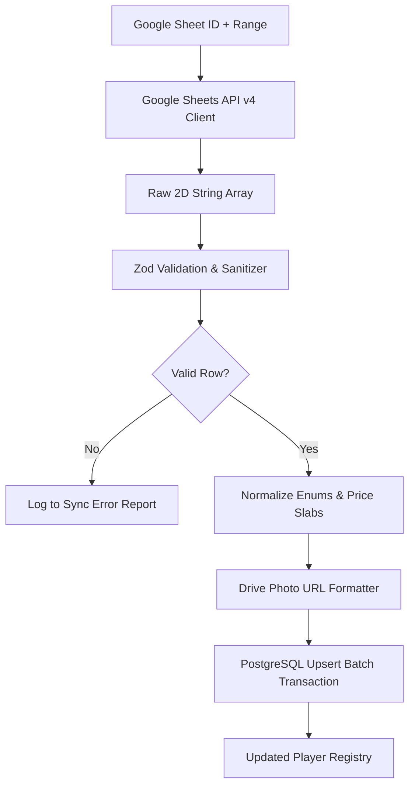

# NTL Auction Platform – Google Sheets & Drive Integration

## 1. Overview
The platform integrates with Google Workspace APIs to enable seamless tournament onboarding:
1. **Google Sheets API v4**: Real-time batch import of player registrations, base prices, categories, and statistics.
2. **Google Drive API v3**: Automatic resolution and proxying of player profile photographs and franchise crests stored in Google Drive folders.

---

## 2. Expected Spreadsheet Schema

The Google Sheet must follow this standard tabular layout:

| Col A: Reg No | Col B: Full Name | Col C: Category | Col D: Role | Col E: Batting Style | Col F: Bowling Style | Col G: Base Price (INR) | Col H: Photo URL / Drive ID | Col I: Notes / Stats |
| :--- | :--- | :--- | :--- | :--- | :--- | :--- | :--- | :--- |
| `NTL-001` | Rohan Sharma | Platinum | All-Rounder | Right Hand | Right Arm Fast | 100000 | `1a2B3c4D5e6F7g...` | 450 runs, 28 wkts (2025) |
| `NTL-002` | Vikram Patel | Gold | Batsman | Left Hand | None | 50000 | `https://drive.google...` | Strike Rate: 142.5 |
| `NTL-003` | Amit Verma | Silver | Bowler | Right Hand | Left Arm Spin | 25000 | `https://drive.google...` | Economy: 6.2 |

---

## 3. Data Ingestion & Normalization Pipeline



### 3.1 Field Parsing Rules
- **Category**: Case-insensitive match against `['ICON', 'PLATINUM', 'GOLD', 'SILVER', 'EMERGING']`. Defaults to `SILVER` if omitted.
- **Role**: Normalizes `Batsman`, `Bat`, `Opening Bat` -> `BATSMAN`; `Bowler`, `Bowl`, `Pacer`, `Spinner` -> `BOWLER`; `All Rounder`, `AR` -> `ALL_ROUNDER`; `Keeper`, `WK` -> `WICKET_KEEPER`.
- **Base Price**: Cleans currency symbols (`₹`, `INR`, `,`, ` `) and parses integer. If blank, infers base price from category floor:
  - `ICON`: ₹2,00,000
  - `PLATINUM`: ₹1,00,000
  - `GOLD`: ₹50,000
  - `SILVER`: ₹25,000
  - `EMERGING`: ₹15,000

---

## 4. Google Drive Photo Asset Resolution

Users frequently paste raw Google Drive sharing URLs (e.g. `https://drive.google.com/file/d/FILE_ID/view?usp=sharing`).
The ingestion pipeline extracts the `FILE_ID` using regex:
```regex
/(?:https:\/\/drive\.google\.com\/(?:file\/d\/|open\?id=)|id=)([a-zA-Z0-9_-]+)/
```
And converts it to a high-speed direct CDN preview URL:
```
https://lh3.googleusercontent.com/d/{FILE_ID}
```
Or streams it through the local Next.js image optimizer route:
```
/api/assets/drive-proxy?id={FILE_ID}
```

---

## 5. Security & Service Account Configuration

1. **Authentication Mode**: Google Cloud Service Account with domain-wide delegation or direct Sheet sharing.
2. **Environment Variables**:
   - `GOOGLE_SERVICE_ACCOUNT_EMAIL`: e.g. `ntl-importer@ntl-auction-platform.iam.gserviceaccount.com`
   - `GOOGLE_PRIVATE_KEY`: Encrypted PEM RSA private key string.
   - `GOOGLE_SHEET_ID`: Target tournament master spreadsheet ID.
3. **Permissions**: The Service Account email only requires read-only (`Viewer`) access to the sheet.
