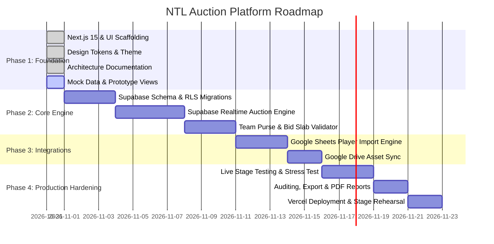

# NTL Auction Platform – Master Plan

## 1. Executive Summary & Vision
The **NTL Auction Platform** is a multi-league cricket auction management system designed specifically for premier tournament management, beginning with the **Nalanda Turf League (NTL) Season 1**.

The platform is engineered to deliver:
1. **Flawless Real-Time Broadcast Visuals**: An ultra-responsive, cinematic live auction interface optimized for ultra-high-definition TVs, stage projectors, and live stream overlays.
2. **Deterministic, High-Integrity Admin Controls**: Comprehensive back-office tools for auctioneers and league commissioners to manage teams, player pools, bids, budgets, and rule enforcement with sub-second latency.
3. **Multi-League Scalability**: Architectural support for hosting distinct tournaments, auction formats (English open outcry, sealed bid, silent auction), and custom bidding rules without schema modifications.

---

## 2. Product Roadmap & Phasing

### Phase 1: Foundation & Scaffold (Current Phase)
- Autonomous Next.js 15 App Router setup with TypeScript strict mode and Tailwind CSS.
- Sports-themed visual design system: Dark charcoal base, emerald turf green accents, metallic gold highlights.
- Dual interface layout: High-contrast Public Stage & Admin Operations Console.
- Mock datasets matching NTL Season 1 roster, teams, and tournament rules.
- Complete architectural specification documentation.

### Phase 2: Auction Engine & Real-Time State
- Supabase PostgreSQL schema with Row Level Security (RLS).
- Realtime channels for instant bid broadcasts, countdown sync, and undo capabilities.
- Transactional bid ledger ensuring zero purse overdrafts or duplicate bids.

### Phase 3: Automation & Ingestion
- Google Sheets API integration with automatic schema mapping and validation.
- Google Drive asset resolution for high-resolution player photos and team vector crests.
- Automatic tier categorization (Icon, Platinum, Gold, Silver, Emerging).

### Phase 4: Stage Readiness & Live Execution
- Stage display mode (keyboard shortcuts for auctioneers: space to pause, arrows for bids, Enter to hammer).
- Offline fallback resilience with local storage snapshotting.
- Live team-wise purse analytics and downloadable post-auction PDF/Excel summaries.

---

## 3. Core Persona Requirements

### Persona A: The Live Auctioneer / Commissioner (Admin Interface)
- Rapid keyboard-driven bid increments (+₹10k, +₹25k, +₹50k, +₹1L).
- Visual indicator showing if a team has remaining purse to legally place a bid.
- Automatic enforcement of minimum squad size vs. remaining purse (reserve calculation).
- 1-click "Hammer Down" (Sold) or "Pass" (Unsold / Retained for Round 2).
- Instant Undo with audit ledger recording.

### Persona B: The Audience & Franchise Owners (Public Display)
- Zero lag (<300ms) sync of current bid, leading bidder, and timer.
- High-impact player cards displaying role (All-Rounder, Batsman, Bowler, Wicketkeeper), batting style, bowling arm, and previous tournament statistics.
- Dynamic franchise purse scoreboard updating in real time.
- Cinematic "SOLD!" confetti animation and hammer gavel sound effect.

---

## 4. Key Success Metrics
| Metric | Target | Rationale |
| :--- | :--- | :--- |
| **Bid Broadcast Latency** | < 150 ms | Ensures broadcast synchronization across stage TVs. |
| **Purse Integrity** | 100% (0 overspends) | Guaranteed by database constraints and transactional atomic locks. |
| **Player Import Speed** | < 3s for 500 players | Fast Google Sheets synchronization during last-minute registrations. |
| **Lighthouse Performance** | > 95 | Optimized asset delivery for projector displays. |
| **Crash Rate** | 0% during live event | Resilient fallback and optimistic UI reconciliation. |
