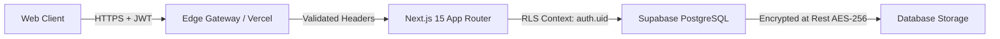

# NTL Auction Platform – Security Standards & Policies

## 1. Zero Trust Architecture
The platform operates on a defense-in-depth model where all client interactions are treated as untrusted until verified by cryptographic signatures and database constraints.

---

## 2. Authentication & Session Management

- **Provider**: Supabase Auth (Email + Secure Magic Link / Passwordless MFA for stage commissioners).
- **Session Tokens**: JWT stored in encrypted, `HttpOnly`, `SameSite=Lax`, `Secure` cookies managed by `@supabase/ssr`.
- **RBAC (Role-Based Access Control)**:
  - `COMMISSIONER`: Full administrative access (create leagues, adjust purses, force hammer, undo bids).
  - `AUCTIONEER`: Operational stage access (call players, place bids, hammer down).
  - `TEAM_REPRESENTATIVE`: Franchise dashboard access (view-only purse tracking and roster verification).
  - `PUBLIC`: Read-only access to broadcast views, live player cards, and public rosters.

---

## 3. Database Row Level Security (RLS)

All tables have RLS enabled by default:
- **`leagues`, `seasons`, `teams`, `players`, `purchases`**:
  - `SELECT`: Permitted for `public` / anonymous callers.
  - `INSERT`, `UPDATE`, `DELETE`: Restricted to authenticated users with `role = 'ADMIN'` in `admin_profiles`.
- **`bids`**:
  - `SELECT`: Permitted for `public`.
  - `INSERT`: Restricted to `sp_place_bid` stored procedure (executed via security definer with strict caller validation).
  - `UPDATE`, `DELETE`: Forbidden. Bids are append-only.
- **`admin_profiles`, `audit_logs`**:
  - `ALL`: Restricted strictly to super-administrators.

---

## 4. API & Input Protection Standards

1. **Schema Validation**: All inbound payloads are parsed and sanitized through Zod schemas before hitting business logic.
2. **Rate Limiting**:
   - Live bidding endpoint: Rate-limited per authenticated session to 10 requests / second to eliminate race conditions.
   - Public live stream endpoints: Edge-cached with stale-while-revalidate (SWR) headers to absorb burst projector reloads.
3. **Secret Hygiene**:
   - `NEXT_PUBLIC_` prefixes are strictly prohibited for service keys, Google private keys, or admin secrets.
   - All environment variables are asserted at startup using `env.mjs` / Zod configuration validation.
   - `.env`, `.env.local`, and service account JSON files are added to `.gitignore`.

---

## 5. Audit Logging

Every critical administrative mutation (purse override, manual player addition, auction pause, undo action) writes an immutable record to `audit_logs`:
- `actor_id`: UUID of the authenticated user
- `action_type`: e.g. `PURSE_ADJUSTMENT`, `UNDO_BID`, `MANUAL_HAMMER`
- `target_id`: ID of the affected team, player, or auction
- `metadata`: JSON diff of pre-state and post-state
- `ip_address`: Remote client IP
- `created_at`: Timestamp
