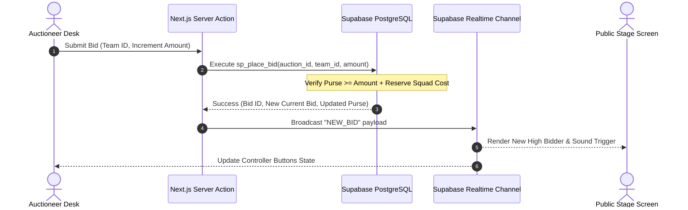
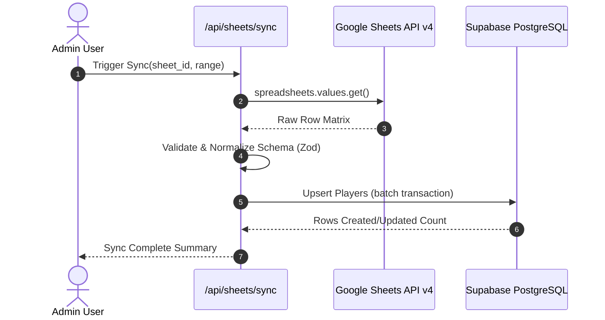

# NTL Auction Platform – System Architecture

## 1. High-Level System Topology

```
+-----------------------------------------------------------------------------------+
|                                 CLIENT BROWSERS                                   |
|                                                                                   |
|   +------------------------------------+   +------------------------------------+ |
|   |         Admin Application          |   |      Public Broadcast Display      | |
|   |  - Responsive Dashboard (Laptop)   |   |  - 4K / Projector Stage Display    | |
|   |  - Realtime Control Desk           |   |  - High Visibility Typography      | |
|   |  - Sheets Importer & Team Manager  |   |  - Confetti & Sound Triggers       | |
|   +-----------------+------------------+   +-----------------+------------------+ |
+---------------------|----------------------------------------|--------------------+
                      | HTTPS / WSS                            | HTTPS / WSS
                      v                                        v
+-----------------------------------------------------------------------------------+
|                             VERCEL EDGE INFRASTRUCTURE                            |
|                                                                                   |
|   +-----------------------------------------------------------------------------+ |
|   |                         Next.js 15 App Router                               | |
|   |  - Server-Side Rendering (SSR) for static initial loads                     | |
|   |  - Route Handlers (/api/sheets, /api/export)                                | |
|   |  - Server Actions for deterministic mutations                               | |
|   +-----------------------+-----------------------------+-----------------------+ |
+---------------------------|-----------------------------|-------------------------+
                            | HTTPS                       | REST / WSS
                            v                             v
+--------------------------------------+   +----------------------------------------+
|          GOOGLE CLOUD APIS           |   |            SUPABASE PLATFORM           |
|                                      |   |                                        |
|  +--------------------------------+  |   |  +-----------------------------------+ |
|  | Google Sheets API v4           |  |   |  | Supabase Auth (Admin/Commissioner)| |
|  | - Direct player roster read    |  |   |  +-----------------------------------+ |
|  +--------------------------------+  |   |  +-----------------------------------+ |
|  +--------------------------------+  |   |  | Supabase Realtime (WSS Broadcast) | |
|  | Google Drive API v3            |  |   |  | - auction_room:auction_id channel | |
|  | - Player & logo CDN assets     |  |   |  +-----------------------------------+ |
|  +--------------------------------+  |   |  +-----------------------------------+ |
|                                      |   |  | PostgreSQL with Row Level Security| |
|                                      |   |  | - Atomic bid transactions         | |
|                                      |   |  | - Trigger-based purse checks      | |
|                                      |   |  +-----------------------------------+ |
+--------------------------------------+   +----------------------------------------+
```

---

## 2. Technology Stack Justification

| Layer | Selection | Justification |
| :--- | :--- | :--- |
| **Framework** | **Next.js 15 (App Router)** | Full-stack React 19 framework providing zero-client bundle overhead for server components, fast streaming, and edge route handlers. |
| **Runtime** | **Node.js 24 compatible** | Modern JavaScript engine with native fetch, web streams, and optimal V8 performance. |
| **Language** | **TypeScript (Strict Mode)** | Compile-time guarantee against undefined bid states, null purses, and type drift. |
| **Styling** | **Tailwind CSS & CSS Tokens** | Fast utility-first CSS enabling bespoke sports themes (charcoal `#0A0E13`, emerald green `#059669`, metallic gold `#F59E0B`). |
| **UI Primitives** | **shadcn/ui & Radix UI** | Unstyled, fully accessible, high-performance accessible UI primitives. |
| **Database** | **Supabase PostgreSQL** | Relational integrity with foreign keys, checks, ACID transactions, and automated migration versioning. |
| **Realtime Sync** | **Supabase Realtime Broadcast** | Low latency (<100ms) WebSockets broadcasting bid states without database polling. |
| **Data Ingestion** | **Google Sheets API v4** | Enables organizers to manage player spreadsheets in familiar Google Sheets and sync directly to DB. |
| **Hosting & CI/CD** | **Vercel** | Zero-configuration global edge distribution with automatic preview builds. |

---

## 3. Data Flow Architecture

### A. Live Bidding Cycle


### B. Google Sheets Ingestion Flow


---

## 4. Multi-Tenant League Isolation
Every resource belongs to a `league_id`.
The platform supports:
- Multiple simultaneous leagues (e.g. NTL, Corporate Cup, Inter-Collegiate Trophy).
- League-specific rules:
  - Base price configurations per player category.
  - Slabs for dynamic bid increments:
    - ₹10,000 – ₹1,00,000 : ₹10,000 step
    - ₹1,00,000 – ₹5,00,000 : ₹25,000 step
    - ₹5,00,000 – ₹10,00,000 : ₹50,000 step
    - ₹10,00,000+ : ₹1,00,000 step
  - Minimum and maximum squad sizes (e.g., Min 15, Max 18 players).
  - Maximum foreign/outstation player caps.
